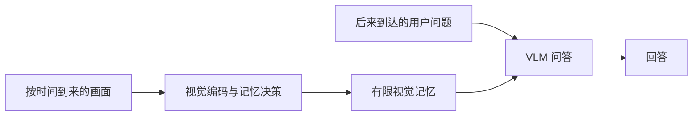

# 从端云 KV 迁移到端侧持续视觉记忆：完整探索与交接

记录截止：2026-10-31。本文是研究主线的完整交接，不是论文结果或已经完成的系统说明。实验细节由仓库中的冻结记录支持；没有保存下来的逐句讨论不伪造为原始会议纪要。相关论文的阅读深度和复现状态见[文献表](RELATED_WORK.md)。

## 1. 我们现在做什么

研究对象是**端侧持续视觉助手的推理部署**：设备接收不断到来的画面，在用户尚未提问时维护有限记忆，提问后用记忆回答。可以归入 agent 推理基础设施，但当前对象比“agentic infra”更具体：持续的记忆写入与间歇的问答如何在实际设备上运行。

用户已确定下一步：先复现 SVMemAgent，用作者代码和模型，测清楚记忆维护与回答各自的时间、内存成本；先不改方法。作者实现和 checkpoint 尚未取得并固定，复现未启动。已做的像素门控试跑不是其替代品。



图中前半段持续发生，后半段由问题触发。分开测量它们，是为了识别成本，**尚不意味着必须联合优化**。在一台设备上，模型常驻、并发、恢复、带宽和功耗可能相关；相关性必须在原始执行中出现，不能人为增加任务制造竞争。

当前科学问题是：在给定设备和回答质量要求下，持续维护这份记忆需要付出多少代价，问题到来后又需要多久才能回答？尚未证明哪个环节主导成本，也没有已成立的新算法贡献。

## 2. 贯穿探索的判断标准

用户最初对端云跨模型 KV 共享有明确兴趣，之后多次要求停止围绕技术找场景。最重要的纠正是：本地有文件、工具或 UI，不代表必须有本地模型；云模型也能通过受控接口调用本地工具。隐私、断网、交互时限和持续感知可以构成本地推理理由，但必须证明它们在具体任务里成立。

端云与普通多智能体的差别也不在“模型数量”：物理隔离、网络往返和可用性、信任边界、互不完整的历史，以及设备资源不对称，会限制可传状态与可执行顺序。若两个模型处在同一 GPU/服务器，不应仅改名称就称为端云。若不同上下文的模型各自能够复用自身前缀，也不能声称独立上下文必然导致双方全量重算。

研究不必从零发明新问题。用户明确接受：以好的已有方法为起点，在端侧跑完整、扩大时长或任务规模、建立可靠成本归因，并解决真实暴露的限制。不能因为别人已经做过选择性感知或在线记忆，就自动否定继续做的价值。

## 3. 第一条主线：跨模型、跨前文的状态复用

### 从共享文件到状态依赖

最初设想是：本地私有模型处理资料，云端大模型提供指导；两边接触同一文件，能否只计算一次，跨两棵推理树共享状态，通过少量修复避免目标 prefill？随后把“合作”拆成算子，而不是把消息交换包装为新框架。

```text
来源模型 A：Hs + X → prefill → 来源 KV / 层入口 E
                                       ↓ 映射、传输或修复
目标模型 B：Ht + X → 目标可用状态 → decode(Q)
```

X 是共同材料，Hs/Ht 是各自前文。即使 X 的文本相同，其隐藏状态也可能依赖前文、权重、位置与注意力掩码。需要分别讨论：同模型/同前文、同模型/不同前文、不同模型/同前文、不同模型/不同前文。共享文件不意味着两个模型的数值 KV 相同，也不意味着各自后续答案的 decode 可以省掉。

还发现一个隐私边界：源输入 `[私有前文 P, 公共材料 X]` 中，仅删除 P 的 KV 行，并不使 X 的状态与 P 无关。既有 64 次 Qwen2.5-0.5B MPS forward 用合成材料检查了这种依赖；这不是新攻击、隐私保证或端云加速证据。详见[状态依赖检查](../experiments/legacy/results/public_kv_dependency_findings.md)。

### 已有方法限制了什么“新意”

DroidSpeak 已研究同架构、不同微调权重间的状态复用、连续层重算、入口 E、离线配置与传输流水化。KVCMAS 是同模型不同前文校正的起点；其同模型假设意味着状态处于共同表示和投影空间，更换权重后不能直接套用原校正。RaReCache 进一步用跨模型映射与选择性重算修复质量，仍有 tokenizer、校准与重算成本约束。CacheBlend/KVComm 则提醒我们，拼接已有块或共享内容时，前文依赖不能忽略。

但“同时不同模型、不同前文”也不能笼统称为空白。后来核对的 XKV 已覆盖异构模型、独立上下文与联合压缩；其操作是更新目标已有 KV 的残差，并不等同于无成本重建目标模型下整段文件的 KV。LCF-X、CacheLink 等分别覆盖另一部分边界。下一位接手不应回到“没人做两轴交叉”的动机。[原始文献与算子审计](../experiments/legacy/results/latent_communication_audit.md)。

### 阶段 A：理想入口值得学吗

为避免先搭系统，我们先问：如果能拿到理想目标层入口，修复是否有足够收益？模型用 Qwen2.5-7B Base→Instruct，同架构以控制形状，不能称为小模型到大模型迁移。HotpotQA 固定开发集 128 题、保留评估集 384 题；实际完成的是 128 题的 P2，不是完整 P0/P1/P2 或 held-out 验收。

P2 中目标前文含一个支持文档，来源前文不含它，共享段含另一支持文档及干扰内容；前文用可见填充等长，避免位置变化混入。它仍是构造性诊断，不是真实 agent 轨迹。固定目标 B(Ht)，比较四套共享缓存 As、At、Bs、Bt；在七个连续四层区间内比较来源入口、前文 oracle、模型 oracle、加法 oracle `E_Bs + E_At − E_As` 和联合 oracle `E_Bt`。E 是 block 首个 RMSNorm 之前的 residual。

| 最终 128 题 P2 结果 | 官方 F1，百分制 | 可以说明什么 |
|---|---:|---|
| 直接使用 As 共享 KV | 48.32 | 双重错配下的具体基线 |
| At：仅模型来源不同 | 55.23 | 前文条件会改变结果 |
| Bs：仅前文来源不同 | 47.79 | 同模型不自动消除前文影响 |
| Bt：完整目标原生状态 | 62.55 | 原生质量参照 |
| 最佳静态加法入口 | 55.34 | 必须比较的强 oracle 对照 |
| 最佳静态联合入口 | 55.39 | 尚未建立比加法可靠更好的证据 |

联合与加法最佳区间同为 [16,20)，差约 0.054 点，描述性配对区间跨零。另一区间有较大信号，但也未建立可靠优势。数值复核还发现 13/896 个原生区间校准生成发生变化，不能把微小分数差写成稳健机制。第 0 层入口可由目标 embedding lookup 获得，中间层 oracle 则依赖额外完整前向；不能把 oracle 的质量当作已经实现的廉价修复。

早期两题、八题实验及精确 KV 替换均保留；其中“完整开发集未运行”等句子已过时。**最终依据是[128 题结果](../experiments/legacy/results/stage_a_full_p2_findings.md)**。有害实体改写与有益内容修复都出现过，不能把所有改善概括为格式变化，也不能从负结果推出“入口没有影响”。当前决定是暂不训练复杂联合入口预测器。

### 状态传输可能比目标重算贵

4090 上两段约 1.2K/1.3K 共享材料的原生前向约 0.132/0.141 秒；未压缩 KV+E 在假设 100 Mbps 下的序列化成本约 5.45/5.93 秒。这是实测计算时间与解析通信预算的对照，**不是实测 WAN 延迟**，也未计预取重叠。它降低的是该设置下按需原样传状态的优先级，不否定所有压缩或异构变体。[成本记录](../experiments/legacy/results/stage_a_7b_findings.md)。

第三方 kvloom 的公开 XKV 译器也实际跑过：Qwen3-0.6B→同模型、四组材料八题。拆分池化与融合后残差逐位相同；四对“改问题”条件中，旧消息与新消息生成 token 相同，没有观察到所预设的失效。真实消息 672 KiB，而材料仅几百字节。这个小样本既不能推广质量，也没有网络实测。用户指定千问后，0.6B→4B 只做了配置/接口检查，未训练译器；不能误写为异构复现成功。[实测](../experiments/legacy/results/latent_question_probe_findings.md)、[模型选择](../experiments/legacy/results/qwen_xkv_pair_decision.md)。

## 4. 回到真实合作：双方究竟重复了什么

我们转向 Minions、PAPILLON、EC²-Bench、AgBench、车载助手、τ² 与公开 GUI 轨迹，目的不是证明 KV 必要，而是看本地模型是否必要、实际传什么、成本在哪。

Minion 的首次两模型实跑失败；换成本地 Qwen2.5-3B 与服务器 7B 后，三道固定上游任务得到与参考一致的目标答案。但长文件主要由本地读一次，云端接收短问题/答案，并没有重复读全文。两道长材料的本地 prompt 处理约 95.90/79.89 秒，云端各次调用 prefill 合计约 0.250/0.260 秒。这里先应考虑端内文档缓存/检索及直接传片段；不能强称跨模型全文 KV 迁移是瓶颈。该结果是三题诊断，不是 benchmark 成绩。[最终实跑记录](../experiments/legacy/results/minions_3b_findings.md)。

PAPILLON 的真实流程是本地隐私处理→云端回答→本地整合；重复内容主要可能在本地前后两次调用。实际测试过提前计算整合提示的已知前缀。中位数样本接续一致，但时间差有冷暖启动混杂；P95 样本输出变化，后来对齐原生分块后改善了接续一致性。接续少花的时间不能漏掉提前计算，也不能把变短的输出当加速；当前无端到端保质加速结论。[重叠实验](../experiments/legacy/results/papillon_overlap_findings.md)、[后续复核](../experiments/legacy/results/papillon_replay_findings.md)。

EC² 源码表明，独立顾问请求仍可能保持自己历史的可复用前缀；截断/改写会改变这种条件。它的结构测试未运行完整 benchmark。车载开源案例中的 offline 开关只切工具数据源，不必然切本地模型。τ² 只完成环境、原生评估器、工具调用与重启检查，没有完成任务。KVCMAS 的原始千问复现固定了代码/配置，但模型实验未执行；2026-10-25 服务器曾有 ENOSPC 与依赖故障，不能把计划当结果。

GUI 方向有两层证据：691 条公开 AndroidWorld 轨迹的第 4 步常见缓存命中下降，只是发布计数；随后在 M4 上用真实 Qwen3-VL-2B 和 Qwen-CUA 原历史构造做受控回放，验证折叠早期截图会缩短前缀复用，并检查原生接续 logits 一致。仍没有在真机 Android 闭环执行动作。CUDA 视觉塔又暴露原生卷积路径的巨大性能差别，说明慢基线和后端设置必须先排除。[计数审计](../experiments/legacy/results/mobile_cache_findings.md)、[受控回放](../experiments/legacy/results/mobile_prefill_replay_findings.md)、[CUDA 检查](../experiments/legacy/results/mobile_vision_cuda_findings.md)。

另有 MoE 专家驻留、流式换入和远端执行的公开路由分析。它们区分了容量、接收字节下界与串行 RTT 依赖，但没有实际执行相应大模型或 WAN agent。不能从理想 oracle 回放推出可部署调度器的收益。[实验账本](EXPERIMENT_LEDGER.md)保留各入口。

## 5. 单设备多模型与多模态：从交换状态转向实际执行

用户提出更现实的组合：量化 Qwen 主模型加 dLLM 草稿，多个 API、上下文依赖和不同芯片共同运行。JointServe 的启发是把模型权重分片和会话 KV 放入共同驻留预算；会话恢复不是不同模型之间共享数值 KV。其 A800、1 TB 主机内存设置不能直接外推手机。

DFlash 进入源码阅读：目标模型和草稿各自有权重与缓存，每轮草稿依赖目标侧提供的条件，目标验证后还需根据接受长度维护状态。异芯片部署要明确中间表示、token、验证结果与同步的真实方向，不能只算草稿 FLOPs。工具调用后的新前文也不能自动解释为“缓存恢复故障”。我们尚未跑 DFlash 的量化主模型、跨芯片或多轮工具任务实验，因而没有成立的瓶颈结论。DSpark、多 batch dLLM、ktransformers 等是讨论过的候选，不是已复现基线。

FocusGUI 的局部结构启发把讨论推向多模态：不同模态依赖、token 选择和动态执行是否需要统一运行时。用户随后要求明确任务，不人为拼入视频生成与语音任务制造资源竞争。FocusGUI 阅读和源码位置保留在[文献表](RELATED_WORK.md)，没有本机模型性能结果。

MiniCPM-o 已能承担实时音视频理解和语音交互，因此“把感知、推理、生成放一起”不是空白。源码检查发现它已有双工线程、队列、跨模块流水、LLM 上下文顺序约束、TTS 跨 chunk 状态及多后端。暂停计算不等于释放状态内存，是有用的成本区分，但不能当作独有新机制。CoreML T2W 状态复制、双份权重等只是进一步测量的候选，尚未证实是瓶颈。没有运行本地 MiniCPM-o 完整模型。[完整审计](MINICPM_O_AUDIT.md)。

## 6. 从“每个请求都算完”到“持续计算是否仍有价值”

用户要求离开小修小补，先发散完全不同的方法。讨论过：大多数时间不推理、过时计算失效、按任务不确定性而非模态分配计算、长期个人化、世界记忆、空闲时预计算。随后收敛到两个问题：持续在线 agent 能否多数时间不唤醒大模型；哪些旧计算已经过时，哪些又是当前理解不可缺少的依赖。

这个方向随后被已有工作挑战。事件触发不是新事；选择性感知、结构化日志唤醒、预测有效期、语义采样和有界在线记忆都有先例。TGL、ActiveSight、StreamSense、StreamAgent、MMEdge、Nanomind、SVMemAgent、StreamMem、AoII 等覆盖不同部分。不能把“少调用大模型”或“事件＋记忆＋唤醒”作为天然新贡献。

我们用 SVMemAgent 论文中第一支口红产品编号的例子讨论依赖：细小但短暂的文字若在入口被过滤，后续再好的记忆选择器也无法恢复。不过这不是 ActiveSight 必败的证据；若任务锚点能覆盖文字事件，其前端与 SVMemAgent 组合可能有效。固定唤醒也未必与记忆维护必须联合。**必须保留这个强组合反驳，不能为了联合优化把依赖写成必然。**

用户要求停止继续找问题，开始跑最可能完成的方向。之后又明确：已有工作不是禁区，能把它 scale 上去、做完整就是价值。因此当前选择 SVMemAgent 为基线，是从成熟方法向实际部署推进，不是声称它已被我们推翻。

## 7. 已经跑了什么：低成本像素门控试验

在选择 SVMemAgent 忠实复现之前，完成过一项独立诊断：低分辨率像素差能否减少视觉编码而保住短暂文字证据。它既不是 ActiveSight，也不是 SVMemAgent，不应用来比较二者优劣。

固定公开 AndroidWorld 数据 12 条轨迹、139 张图；开发集 6 条/50 张、保留集 6 条/89 张。每个策略保留 4 张 FIFO 图及视觉输出。阈值只用开发集选择，最终门槛是证据召回相对全编码下降不超过 2 个百分点且更快。M4/16 GiB 上真正执行 Qwen3-VL-2B 视觉塔、BF16/MPS/SDPA，四策略×六保留轨迹×三次交错重复，共 72 条实际计时记录。

| 策略 | 编码次数 / 89 | 原始 OCR 召回 | 去调试叠层敏感性召回 | 回放中位时间 |
|---|---:|---:|---:|---:|
| 全编码 | 89 | 100% | 100% | 52.733 秒 |
| 每两步采样 | 46 | 63.58% | 62.50% | 26.178 秒 |
| 与最近保留帧比较 | 73 | 95.52% | 97.64% | 41.703 秒 |
| 与四张保留帧比较 | 62 | 95.22% | 97.30% | 35.947 秒 |

OCR 是参考代理，不是真值或 QA 准确率；发现顶部调试叠层后做了敏感性审计，没有用清洗后的保留集重新调参。四帧比较少用约 31.83% 时间，但质量门槛未通过。

后验选出的费用录入案例又用完整 Qwen3-VL-2B 实际生成：问 Clothes 右侧的标签，全编码保留 [8,9,10,11] 回答 **Health Care**；最近帧策略保留 [5,6,7,11] 回答 **UNKNOWN**；四帧策略保留 [4,5,6,7] 回答错误的 **Social**。这证明该冻结策略在此例丢失关键证据，不估计总体 QA 成功率。

计时不含摄像头、LLM decode 或语音，未测功耗。记录的内存是每条轨迹末端 allocated/driver memory，**不是峰值**。是真实 Mac 算子和截图回放，不是穿戴设备、手机或连续摄像头的闭环验证。原始[协议](../experiments/legacy/stream_gate/PROTOCOL.md)、[结果](../experiments/legacy/stream_gate/RESULTS.md)、逐步选择、OCR、计时和输出全部归档，10 项可执行回归随仓库保存。

## 8. 下一步与停止条件

下一步只推进 SVMemAgent 原版复现：确认官方代码/checkpoint与许可，固定作者配置，先跑通一个原始样本并核对记忆状态、输入和答案，再在端侧分别测持续写入与查询响应。若作者资源未公开或不能取得，明确阻塞及查证范围，不能默写一个模型作为替代。

先交付一张真实成本分解表：记忆维护、QA、权重/状态驻留、峰值内存、失败；注明设备、时长、采样率、记忆容量、冷暖启动和计时同步。功耗若尚无有效测量工具，就保留未测。先不改帧率、量化、裁剪策略或模型来“跑得起来”后宣称原版复现成功；必要适配须单列与作者设置的差异。

若原始方法在目标设备已足够快、内存可接受，下一步可以扩大持续时长和任务覆盖，观察真正的限制。若瓶颈只在 QA 大模型，不能继续把 writer 当主矛盾；若需要另一个基线，应由测量或兼容障碍说明原因。联合优化、低功耗、状态共享均保留为候选，尚未批准为既定新机制。

接手者直接从 [HANDOFF](HANDOFF.md) 开始。无需重复询问“我们要做什么”，也不要把这份探索史改写成已有正结果的论文。
